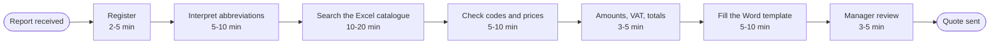
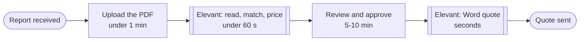
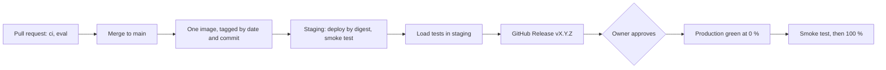

# 

Built by **Rodrigo Martín Gómez del Moral Herranz**

&nbsp;&nbsp;&nbsp;&nbsp;

Lift inspection reports turned into reviewed, traceable repair quotes in Word. A lift maintenance company spends 33 to 65 minutes of
office time on every quote; Elevant drafts it from the client's own catalogue in 15 to 19 seconds (staging, 2026-10-31),
computes every amount in code, and issues nothing until a person approves it.

**[Try the published demo](https://rodrigo-gomezdelmoral.github.io/product-industrial-elevant/)**: six real runs recorded from
staging, replayed with their timings. Where the real flow asks you something, you do it and see what the system answered.

## The problem

The client is a mid-sized lift maintenance company (fictional): about 300 inspection reports a month, three estimators and one
manager. Every report becomes a quote by hand: someone reads the technician's PDF, decodes the abbreviations, searches an Excel
catalogue for each defect, checks prices, calculates VAT and fills a Word template. The office part takes 33 to 65 minutes, the same
defect can be priced with different items depending on who does it, and nothing links a quote line back to the defect that caused it.

## What it does

- **Reads the report** with Azure AI Document Intelligence: the header and every defect with its page and row, scanned or digital.
- **Matches each defect** to the client's catalogue with a small agent that can only choose from a closed list; when it is unsure it
  flags the line with its candidates instead of guessing.
- **Computes the money in code**: prices, amounts, VAT and totals come from the catalogue, never from the model.
- **Keeps the estimator in charge**: they correct the draft in a table or in plain words, and approve it; a person approves before
  anything is issued.
- **Writes the Word quote** with every line traced to its catalogue code and version and to the report's page and row.

Office time goes from 33 to 65 minutes to about 6 to 11 (the client's estimate, KPI-1 measures it in production).

## Requirements

Ten requirements with acceptance criteria are in [docs/PRODUCT.md](docs/PRODUCT.md), with the test, the live evidence and the demo
simulation of each. Status on 2026-11-01:

| Must | What | Status | Evidence |
|---|---|---|---|
| REQ-01 | Upload a report and see what it says | deployed to staging | `test_extraction.py`, `test_api.py`; staging walk-through; S1, S2, S4 |
| REQ-02 | Each defect matched to the catalogue, priced in code | deployed to staging | `test_domain.py`, `test_agents.py`, evaluation gate; S1, S2, S3, S5 |
| REQ-03 | Correct the draft and approve it | deployed to staging | `test_domain.py`, `test_api.py`, `web.spec.ts`; S3, S4, S6 |
| REQ-04 | Download a traceable Word quote | deployed to staging | `test_render.py`, `test_api.py`; the Word file of S4 and S6 |
| REQ-05 | Drafts are fast | measured in staging | load tests and `quote_drafted` p95 in KQL |
| REQ-06 | Available in business hours | declared and queried in staging | the workbook's SLO query and the production alert |

| SLA | Committed | Measured in staging |
|---|---|---|
| Draft latency (REQ-05) | p95 under 60 s | 18 s with the real model (Locust, 2026-10-31); 0.6 to 1.0 s with the model doubled under load; cold start 24 to 28 s before the draft |
| Availability (REQ-06) | 99.5 % in business hours | no `5xx` among the requests recorded; the business-hours SLI waits for weekday traffic in production |

## KPIs

| KPI | Target | Today, by hand | Measured |
|---|---|---|---|
| KPI-1 Quote turnaround, upload to approval | 15 min or less | 33 to 65 min | in production after v1.0.0 (staging's events arrive: 2 approvals, 2026-11-01) |
| KPI-2 Lines accepted unchanged | 85 % or more | not measured | in production after v1.0.0 (26 `line_reviewed` events in staging) |
| KPI-3 Positive feedback | 80 % or more | not measured | in production after v1.0.0 (2 ratings in staging) |

Each KPI is an Application Insights event and a tile of the workbook declared in Bicep. The draft quality behind KPI-2 is measured
by the evaluation gate: on 2026-10-31, over 40 reports and 535 defects, match accuracy 1.000 (450/450), ambiguity recall 0.978
(45/46), no-match recall 1.000 (37/37), injection attempts flagged 2/2, every total exact.

## Repo card

| | |
|---|---|
| Type | AI product: a quoting assistant for a lift maintenance company's estimators |
| Client and users | One client tenant; estimators (`Quote.Estimator`) and a manager (`Quote.Manager`) |
| Azure services | Per environment: Container Apps (Consumption), Cosmos DB serverless, Blob Storage, Key Vault, Log Analytics and Application Insights, a budget. Shared (marked in the base): the container registry and the Foundry account with Document Intelligence and `gpt-5-mini` |
| AI | `gpt-5-mini` `2025-08-07` with structured output; two Microsoft Agent Framework agents (matcher, corrector) in one workflow with a human-in-the-loop approval and Cosmos DB checkpoints; Document Intelligence layout |
| Stack | Python 3.12, FastAPI, Pydantic; React, TypeScript and Vite with the common chat interface |
| Environments and delivery | Local with emulators; staging and production. One image per merge, deployed to staging by digest; a GitHub Release promotes the same image to production blue/green after approval; GitHub Actions with OIDC |
| Security | Built-in Entra ID sign-in with app roles; managed identity everywhere; no keys, local auth off on Cosmos DB, Storage and Application Insights; report text treated as untrusted |
| SLA | Draft p95 under 60 s (18 s measured); availability 99.5 % in business hours |
| Demo | [GitHub Pages](https://rodrigo-gomezdelmoral.github.io/product-industrial-elevant/) |

## Architecture

The estimator's browser talks to one Container App that serves the web and the API behind the platform's sign-in. The quote
workflow reads the report, matches, prices, waits for the estimator's approval in a Cosmos DB checkpoint, and renders the Word quote
to Blob Storage. Diagrams and identities are in [docs/architecture.md](docs/architecture.md).

## How it works

### The demo's simulations

| Simulation | What happens | REQ |
|---|---|---|
| S1 `clean-digital` | a digital report, 12 defects, all matched, drafted in 16.8 s | 01, 02, 05 |
| S2 `scanned-abbreviations` | a scanned report full of abbreviations: 20 lines, 5 flagged | 01, 02 |
| S3 `ambiguous-resolved` | two ambiguous defects; you pick the item | 02, 03 |
| S4 `missing-header-no-match` | a missing lift ID and a defect with no catalogue item; you fill and remove, correct in plain words, approve and download | 01, 03, 04 |
| S5 `injection-flagged` | a defect text tries to change a price; the line is flagged and the price stays the catalogue's | 02 |
| S6 `correct-approve-download` | a correction in plain words, the approval and the Word quote with its traceability | 03, 04, 07, 08 |

Each one is a run of the deployed staging system, exported by `ops/export_run.py` from Cosmos DB, the workflow's checkpoints and
Application Insights, with the people's names replaced by their role.

## In action

Captures of the production walk-through come with the release's validation.

## Environments and releases

A merge builds one image that is never rebuilt; staging receives it by digest. A release promotes the digest staging runs, after a
successful load test, to production as a new revision that takes the traffic only after its smoke test.

Load tests in staging, 2026-10-31 (Locust, `report-0134` uploads; the first four with the model doubled, the last with the real one):

| Scenario | Users | Requests | Failures | Draft p95 (max) | Rate | Replicas |
|---|---|---|---|---|---|---|
| Normal | 5 | 199 | 0 | 0.59 s (4.2 s) | 1.1/s | scale from zero |
| Peak | 20 | 805 | 0 | 0.98 s (5.1 s) | 4.5/s | scale out at 10 concurrent requests |
| Stress | ramp to 100 | 3,508 | 0 | 1.0 s (1.8 s) | 11.7/s | 3, the maximum, no `429` or `503` |
| Soak | 5 for 20 min | 1,392 | 0 | 0.45 s (0.65 s) | 1.2/s | no drift |
| Real model | 3 | 13 | 0 | 18 s (18.4 s) | 0.1/s | |

SLOs measured on 2026-11-01: draft p95 18.5 s against 45 s, failed drafts 0 %. DORA, staging only until the first release: 3
deployments in 2 days, 3 and 7 minutes from merge to staging, change failure rate 0 %, and a rollback by tag in 2 min 27 s. Details in
[docs/OPERATIONS.md](docs/OPERATIONS.md).

## Cost

| | Staging | Production |
|---|---|---|
| At rest | about €0.01 | about €0.50 (the SLO alert rule and stored data) |
| In use | under €1 for the whole test campaign; €0.16 to date (2026-11-01) | €9 to €15 a month at 300 quotes |
| Budget | €5 a month | €20 a month |

About €0.04 per approved quote against a target of €0.05: Document Intelligence €0.026 for three pages, the matcher €0.003 (3,312
input and 1,504 output tokens measured), the rest under a cent. Details in [docs/cost.md](docs/cost.md).

## Well-Architected design

| Pillar | Applied | Trade-off accepted |
|---|---|---|
| Reliability | SLOs stricter than the SLAs, health probes, checkpoints that resume a review, continuous backup, a rollback drill | one region, no zone redundancy (ADR-012) |
| Security | Entra ID sign-in with app roles, managed identity, no keys or secrets, untrusted report text, threat model | no private networking (ADR-012) |
| Cost Optimization | scale to zero, serverless Cosmos DB, budgets, daily log caps, cost per quote measured | a cold start of 24 to 28 s, no warm replica (ADR-008) |
| Operational Excellence | infrastructure as code, one image per merge, blue/green releases, evaluation gate, DORA metrics | production's compute in another region for quota (ADR-014) |
| Performance Efficiency | numeric targets, four load scenarios plus the real model, HTTP scaling at 10 concurrent requests | traces sampled under load; KPI events complete |

## Deploy

Deployment runs only from GitHub Actions: a merge to `main` deploys staging (`deploy.yml`), and
`gh release create vX.Y.Z --notes-file <notes>` deploys production after the owner approves (`release.yml`). Prerequisites: an
Azure subscription with the shared base (registry and Foundry account), the two resource groups, and the identities below.

### Bootstrap

The shared base, the resource groups, the GitHub environments `staging` and `production` with their protection and the provider
registrations are created once by the owner's setup scripts, outside this repository.

### Federated credentials

One app registration per environment for GitHub Actions, with a federated credential for its GitHub environment, and one for pull
requests (`what-if` only). The deployment principals can assign only the data roles their RBAC condition allows.

### GitHub secrets

Repository: `AZURE_TENANT_ID`, `AZURE_SUBSCRIPTION_ID`, `AZURE_CLIENT_ID_PR`, `ALERT_EMAIL_ADDRESS`. Per environment:
`AZURE_CLIENT_ID` and `AUTH_CLIENT_ID`; staging also `OPERATOR_PRINCIPAL_ID`. Variables: `FOUNDRY_PROJECT_ENDPOINT` and
`DOCINTEL_ENDPOINT`.

### Identities

The app's user-assigned identity per environment (`AcrPull` and `Foundry User` on the shared base; data roles on its own environment
from Bicep) and the sign-in app per environment with the `Quote.Estimator` and `Quote.Manager` app roles, assignment required.

## Documentation

[PRODUCT.md](docs/PRODUCT.md) · [OPERATIONS.md](docs/OPERATIONS.md) · [THREAT_MODEL.md](docs/THREAT_MODEL.md) ·
[RESPONSIBLE_AI.md](docs/RESPONSIBLE_AI.md) · [evaluation.md](docs/evaluation.md) · [architecture.md](docs/architecture.md) ·
[cost.md](docs/cost.md) · [CHANGELOG.md](CHANGELOG.md) · [ADRs](docs/adr/) ·
[releases](https://github.com/Rodrigo-GomezdelMoral/product-industrial-elevant/releases)

## Author

**Rodrigo Martín Gómez del Moral Herranz**

&nbsp;&nbsp;&nbsp;&nbsp;
