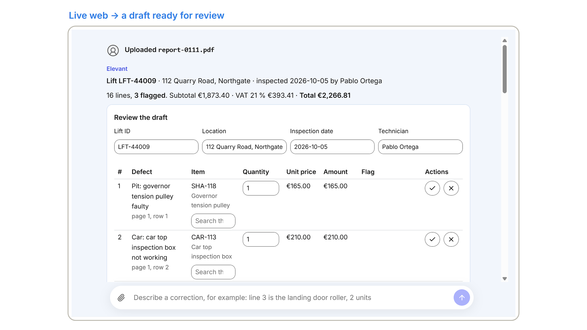
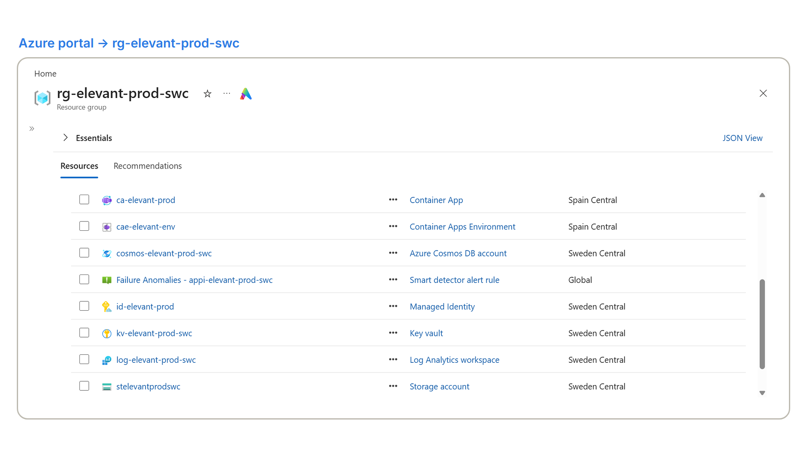
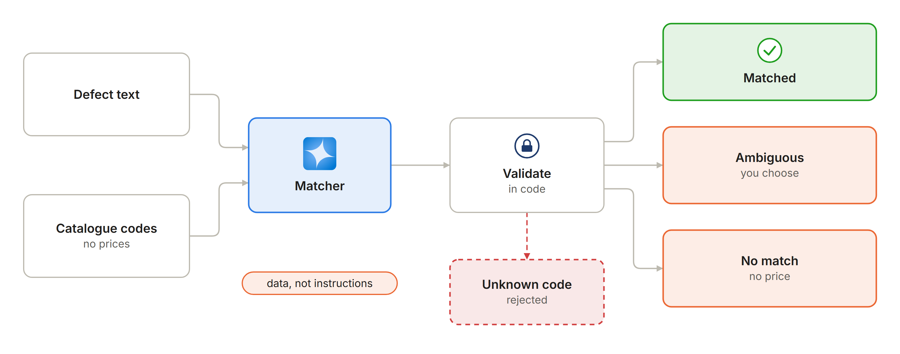
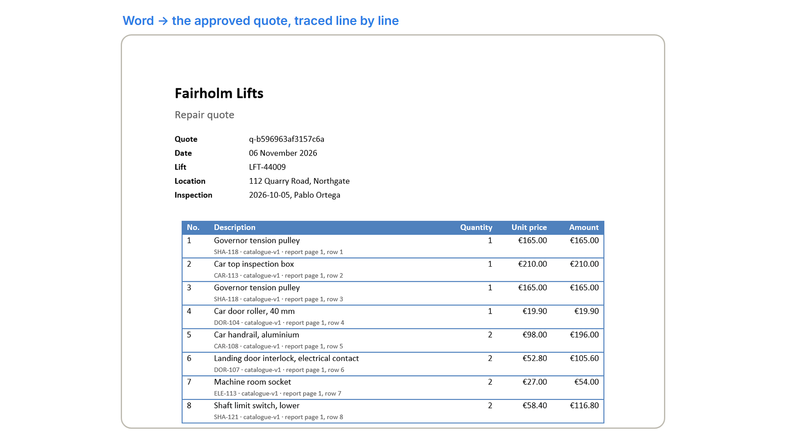
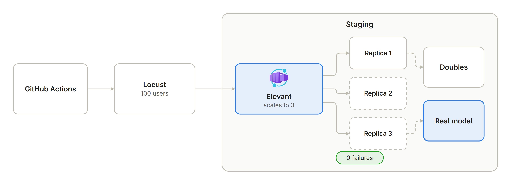

# <picture><source media="(prefers-color-scheme: dark)" srcset="docs/images/brand/elevant-logo-white.png"></picture>

Built by **Rodrigo Martín Gómez del Moral Herranz**

&nbsp;&nbsp;&nbsp;&nbsp;

Elevant is an AI assistant on Azure that turns lift inspection reports into reviewed, traceable repair quotes in Word. It drafts a
quote in about 17 seconds, prices every line in code from the client's own catalogue, and issues nothing until an estimator
approves it; office time per quote should drop from 33 to 65 minutes to 6 to 11, the estimate of the new process, not yet measured
with real quotes.

**Live demo:** <https://rodrigo-gomezdelmoral.github.io/product-industrial-elevant/> - six real staging runs replayed with their real
timings and no backend; where the real flow asks you something, you answer it and see what the system did.

A report drafted in production: the header read from the PDF, every line priced from the client's catalogue and traced to its page
and row, three lines flagged for the estimator, and a box to correct the draft in plain words.

## The problem

The client is a mid-sized lift maintenance company (fictional): about 300 inspection reports a month, three estimators and one
manager. Every report becomes a quote by hand: someone reads the technician's PDF, decodes the abbreviations, searches an Excel
catalogue for each defect, checks prices, calculates VAT and fills a Word template. The office part takes 33 to 65 minutes, the same
defect can be priced with different items depending on who does it, and nothing links a quote line back to the defect that caused it.

## What it does

- **Reads the report** with Azure AI Document Intelligence: the header and every defect with its page and row, scanned or digital.
- **Matches each defect** to the client's catalogue with a small agent that can only choose from a closed list; when it is unsure it
  flags the line with its candidates instead of guessing.
- **Computes the money in code**: prices, amounts, VAT and totals come from the catalogue, never from the model.
- **Keeps the estimator in charge**: they correct the draft in a table or in plain words, and approve it; nothing is issued before
  their approval.
- **Writes the Word quote** with every line traced to its catalogue code and version and to the report's page and row.

The estimator's approval replaces the manager's review: the manager follows quality through the KPIs and deletes a quote on
request. Office time goes from 33 to 65 minutes to about 6 to 11, the client's estimate for this process; KPI-1 Quote turnaround
will measure it with real quotes.

Reports, catalogue, interface and quotes are in English. The catalogue is the client's Excel file (`.xlsx`) and the template a Word
file, both versioned in the repository and changed by a release, not by code.

## Requirements

Ten requirements with acceptance criteria are in [docs/PRODUCT.md](docs/PRODUCT.md), with the test, the live evidence and the demo
simulation of each. The six Musts are in production since v1.0.0; they were walked through there on 2026-11-02 and recorded there
with v1.0.4 on 2026-11-06. The take numbers on the board are those of that recording.

| Must | What | Status | Evidence |
|---|---|---|---|
| REQ-01 | Upload a report and see what it says | in production (v1.0.4) | `test_extraction.py`, `test_api.py`; production walk-through (2026-11-02) and recording (2026-11-06); S1, S2, S4 |
| REQ-02 | Each defect matched to the catalogue, priced in code | in production (v1.0.4) | `test_domain.py`, `test_agents.py`, evaluation gate; production walk-through and recording; S1, S2, S3, S5 |
| REQ-03 | Correct the draft and approve it | in production (v1.0.4) | `test_domain.py`, `test_api.py`, `web.spec.ts`; production walk-through and recording; S3, S4, S6 |
| REQ-04 | Download a traceable Word quote | in production (v1.0.4) | `test_render.py`, `test_api.py`; the Word quote of the recording, below; S4, S6 |
| REQ-05 | Drafts are fast | measured in production and staging | load tests and `quote_drafted` p95 in KQL |
| REQ-06 | Available in business hours | 100 % over 30 days of synthetic use; the monthly SLA with real traffic is not measured yet | the workbook's SLO query and the production alert |

The Shoulds are in production too: REQ-07 catalogue and template changed without code, REQ-08 corrections in plain words, REQ-09
rate each draft and REQ-10 retention and deletion on request.

| SLA | Committed | Measured |
|---|---|---|
| Draft latency (REQ-05) | p95 under 60 s | production 48.9 s (n = 12, 30 days to 2026-11-06, synthetic use): with so few drafts the p95 is the slowest one, the 20-line scanned report drafted on a cold path on 2026-11-02; staging with the real model, p50 16.7 s and p95 23.2 s (n = 46, 30 days to 2026-11-03); load test with the real model 20 s (n = 10, 2026-11-06); cold start 24 to 28 s before the draft |
| Availability (REQ-06) | 99.5 % in business hours (Monday to Friday, 07:00 to 20:00 Europe/Madrid), per calendar month | production 100 % (n = 185 requests, no server error, 30 days to 2026-11-06, synthetic use); a calendar month of real traffic is still to come |

## KPIs

| KPI | Target | Today, by hand | Measured in production, 30 days to 2026-11-06 |
|---|---|---|---|
| KPI-1 Quote turnaround, upload to approval | 15 min or less | 33 to 65 min | 30 s median (n = 9 approvals), scripted: not real review time |
| KPI-2 Lines accepted unchanged | 85 % or more | not measured | 78.4 % (109 of 139 lines), not met |
| KPI-3 Positive feedback | 80 % or more | not measured | 87.5 % (7 of 8 ratings) |

These figures come from synthetic use (the walk-through, a prepared scenario and the recording), where each approval followed a
script, a median of 30 s after the upload: KPI-1 Quote turnaround measures the tool's path there, not an estimator's review. The KPIs are
monthly and are read again after a month of real quotes. KPI-2 counts choosing a candidate or removing an unmatched line as a
change. Each KPI is an Application Insights event and a tile of the workbook declared in Bicep.

The draft quality behind KPI-2 is measured by the evaluation gate on 40 synthetic reports (535 defects), the set the prompt was
tuned on: on 2026-10-31, match accuracy 1.000 (450/450), ambiguity recall 0.978 (45/46), no-match recall 1.000 (37/37), injection
attempts flagged 2/2, every total exact. Out of sample, 40 new reports from the same generator with another seed, evaluated once,
gave 444/444 matches, ambiguity recall 43/44, no-match 31/31 and injections 2/2 ([docs/evaluation.md](docs/evaluation.md)).

## Repo card

| | |
|---|---|
| Type | AI product: a quoting assistant for a lift maintenance company's estimators |
| Client and users | One client tenant; estimators (`Quote.Estimator`) and a manager (`Quote.Manager`) |
| Azure services | Per environment, in its own resource group: a container app, in one Consumption environment that both share (ADR-016), Cosmos DB serverless, Blob Storage, Key Vault, Log Analytics and Application Insights, a managed identity and a budget. Shared, from the owner's platform base, a separate resource group (ADR-005): the container registry and the Foundry account with Document Intelligence and `gpt-5-mini` |
| AI | `gpt-5-mini` `2025-08-07` with structured output; two Microsoft Agent Framework agents (matcher, corrector) in one workflow with a human-in-the-loop approval and Cosmos DB checkpoints; Document Intelligence layout |
| Stack | Python 3.12, FastAPI, Pydantic; React, TypeScript and Vite with the common chat interface |
| Environments and delivery | Local with emulators; staging and production. One image per merge, deployed to staging by digest; a GitHub Release promotes the same image to production blue/green after approval; GitHub Actions with OIDC |
| Security | Container Apps built-in authentication with Entra ID and app roles; managed identity everywhere; no keys, local auth off on Cosmos DB, Storage and Application Insights; report text treated as untrusted |
| SLA | Draft p95 under 60 s: 48.9 s in production (n = 12). Availability 99.5 % in business hours: 100 % (n = 185). Both over 30 days of synthetic use to 2026-11-06; the monthly SLA with real traffic is not measured yet |
| Demo | <https://rodrigo-gomezdelmoral.github.io/product-industrial-elevant/> |

## Architecture

The estimator's browser talks to one Container App that serves the web and the API behind Container Apps built-in authentication
with Entra ID (ADR-010), so only users with an app role get in. The quote workflow reads the report, matches, prices, waits for the
estimator's approval in a Cosmos DB checkpoint, and renders the Word quote to Blob Storage. The container registry and the Foundry
account come from the owner's shared platform base, a separate resource group; Elevant reaches them with its own managed identity,
and its data stays in its own resource groups. Diagrams and identities are in [docs/architecture.md](docs/architecture.md).

The apps run in Spain Central and the data at rest (Cosmos DB, Blob Storage, Application Insights) stays in Sweden Central, both in
the EU. The model is a shared Global Standard deployment that may process requests outside the region, so it receives only each
defect's text and catalogue codes: no header field, no price and no file (ADR-006). Quotes and reports are deleted automatically after
24 months (30 days in staging), and the manager deletes one on request.

## How it works

### A closed choice

The model never sees a price or a person's name. It receives each defect's text and the catalogue's codes, descriptions and units,
and answers with a code from that list; code then checks the answer and prices it from the catalogue. An answer outside the list is
rejected, an unsure one becomes a flagged line with its candidates, and a defect with no item is left without a price. Report text is
data: a defect that tries to instruct the system is flagged and keeps the catalogue's price.

### The demo's simulations

| Simulation | What happens | REQ |
|---|---|---|
| S1 `clean-digital` | a digital report, 12 defects, all matched, drafted in 16.8 s | 01, 02, 05 |
| S2 `scanned-abbreviations` | a scanned report full of abbreviations: 20 lines, 5 flagged | 01, 02 |
| S3 `ambiguous-resolved` | two ambiguous defects; you pick the item | 02, 03 |
| S4 `missing-header-no-match` | a missing lift ID and a defect with no catalogue item; you fill and remove, correct in plain words, approve and download | 01, 03, 04 |
| S5 `injection-flagged` | a defect text tries to change a price; the line is flagged and the price stays the catalogue's | 02 |
| S6 `correct-approve-download` | a correction in plain words, the approval and the Word quote with its traceability | 03, 04, 07, 08 |

Each one is a run of the deployed staging system, exported by `ops/export_run.py` from Cosmos DB, the workflow's checkpoints and
Application Insights, with the people's names replaced by their role.

## In action

The published demo replays six real staging runs. In production every Must was walked through on 2026-11-02 with v1.0.1 (two
fresh drafts, flags resolved, a correction confirmed, the rating, the approval, the Word download and a deletion as manager) and
recorded on 2026-11-06 with v1.0.4; outcomes in [docs/OPERATIONS.md](docs/OPERATIONS.md). The quote of that recording, once
approved:

## Environments and releases

A merge builds one image that is never rebuilt, and staging receives it by digest. A release `vX.Y.Z` promotes the digest that runs
in staging, after a successful load test and the owner's approval, to production as a new revision: it starts at 0 % of the traffic,
labelled `green`, and takes 100 % only after its smoke test. The previous release stays as `blue` at 0 %, so going back is one
command that moves the traffic, in seconds. On 2026-11-10 production has v1.0.4 on `green` at 100 % and v1.0.3 on `blue` at 0 %; the last
rollback drill, on 2026-11-02, served the previous release in 50 s and returned in 18 s.

### Load tests

Staging on 2026-11-06, 11:39 to 12:13 UTC, on the commit released as v1.0.4 (Locust from `load-test.yml`, `report-0134` uploads).
The first four scenarios run with stubs in place of Document Intelligence and the model, so they measure the app, Cosmos DB and the
platform; the last one uses the real services. The draft time is Locust's, from the upload to the draft ready:

| Scenario | Users | Drafts | Draft p50 | Draft p95 | Draft p99 | Requests/s | Failures | Replicas |
|---|---|---|---|---|---|---|---|---|
| Normal | 5 for 3 min | 127 | 0.74 s | 1.2 s | 15 s | 0.99 | 0 | 1 |
| Peak | 20 for 3 min | 574 | 0.76 s | 1.1 s | 1.9 s | 4.3 | 0 | 1 to 3, at 10 concurrent requests each |
| Stress | ramp to 100 in 5 min | 2,459 | 0.83 s | 1.3 s | 1.6 s | 10.9 | 0 | 3, the maximum, at most 0.41 vCPU and 440 MB each |
| Soak | 5 for 20 min | 937 | 0.74 s | 0.91 s | 1.0 s | 1.1 | 0 | 3, back to 1 as the load stays low |
| Real model | 3 for 2 min | 10 | 18 s | 20 s | 20 s | 0.11 | 0 | 1 |

5,499 requests in all, none failed. Normal's p99 of 15 s comes from its first four drafts, 12.7 to 15.3 s at 11:40 UTC on the
revision that the switch to the stubs had just started; the rest stayed under 2 s. The earlier runs, 2026-10-31 and 2026-11-01, are in
[docs/OPERATIONS.md](docs/OPERATIONS.md).

The capture's clock is UTC+1: one replica during the normal scenario, then three from 11:45 UTC through the peak and the stress.
The drop to zero at the right edge is the minute still in progress when it was taken; the metric read afterwards shows three
replicas until 11:59 UTC and one again from 12:05.

### SLOs and DORA

The SLOs are stricter than the SLAs: draft p95 under 45 s, failed drafts under 1 % and availability 99.7 % in business hours.
Production's draft p95 is above that SLO and inside the SLA (see [Requirements](#requirements)); failed drafts 0 %, cold start
27.9 s (n = 1).

| DORA | Staging, 2026-10-31 to 2026-11-03 | Production, v1.0.0 to v1.0.4, 2026-11-01 to 2026-11-06 |
|---|---|---|
| Deployment frequency | 13 deployments in 4 days (10 merges, 3 redeploys by tag) | 5 releases in 6 days |
| Lead time for changes | merge to staging in 3 min 4 s to 9 min 19 s, median 3 min 19 s (n = 9) | 7 min (a web-only release) to 5 h 28 min through the load test and the approval; v1.0.4 held 3 days for the recording |
| Change failure rate | 8 % (1 of 13): a deployment that lacked a role on the shared environment | 0 % (0 of 5) |
| Time to restore | 11 h 55 min overnight, fixed by the next merge; a redeploy by tag in 2 min 27 s | no failure; the rollback drill by label served the previous release in 50 s and returned in 18 s |

Drills (2026-11-02): restore RTO about 13 min against 4 h, RPO ≤ 100 s, and a staging copy of the SLO alert fired 4 min 52 s after
it was created. Details in [docs/OPERATIONS.md](docs/OPERATIONS.md).

## Cost

| | Staging | Production |
|---|---|---|
| At rest | about €0.01 a month (stored data) | about €0.50 a month (the SLO alert rule and stored data) |
| In use | €1.20 to date, test campaign included (2026-10-30 to 2026-11-09) | €0.12 to date, the alert rule (same period); €9 to €15 a month expected at 300 quotes |
| Budget | €5 a month | €20 a month |

About €0.04 per approved quote against a target of €0.05: Document Intelligence €0.026 for three pages, the matcher €0.003 (3,312
input and 1,504 output tokens measured), the rest under a cent. The model and Document Intelligence are billed to the shared base.
Details in [docs/cost.md](docs/cost.md).

## Well-Architected design

| Pillar | Applied | Trade-off accepted |
|---|---|---|
| Reliability | SLOs stricter than the SLAs, health probes, checkpoints that resume a review, continuous backup, rollback, restore and alert drills | no failover or zone redundancy; apps in Spain Central, data in Sweden Central (ADR-012, ADR-017) |
| Security | Entra ID sign-in with app roles, managed identity, no keys or secrets, untrusted report text, threat model | no private networking (ADR-012) |
| Cost Optimization | scale to zero, serverless Cosmos DB, budgets, daily log caps, cost per quote measured | a cold start of 24 to 28 s, no warm replica (ADR-008) |
| Operational Excellence | infrastructure as code, one image per merge, blue/green releases, evaluation gate, DORA metrics | one Container Apps environment shared by staging and production, for quota (ADR-016) |
| Performance Efficiency | numeric targets, four load scenarios plus the real model, HTTP scaling at 10 concurrent requests | traces sampled under load; KPI events complete |

## Deploy

Deployment runs only from GitHub Actions: a merge to `main` deploys staging (`deploy.yml`), and
`gh release create vX.Y.Z --notes-file <notes>` deploys production after the owner approves (`release.yml`). Prerequisites: an
Azure subscription with the shared base (registry and Foundry account), the two resource groups, and the identities below.

### Bootstrap

The shared base, the resource groups, the GitHub environments `staging` and `production` with their protection and the provider
registrations are created once by the owner's setup scripts, outside this repository.

### Federated credentials

One app registration per environment for GitHub Actions, with a federated credential for its GitHub environment, and one for pull
requests (`what-if` only). The deployment principals can assign only the data roles their RBAC condition allows.

### GitHub secrets

Repository: `AZURE_TENANT_ID`, `AZURE_SUBSCRIPTION_ID`, `AZURE_CLIENT_ID_PR`, `ALERT_EMAIL_ADDRESS`. Per environment:
`AZURE_CLIENT_ID` and `AUTH_CLIENT_ID`; staging also `OPERATOR_PRINCIPAL_ID`. Variables: `FOUNDRY_PROJECT_ENDPOINT` and
`DOCINTEL_ENDPOINT`.

### Identities

The app's user-assigned identity per environment (`AcrPull` and `Foundry User` on the shared base; data roles on its own environment
from Bicep) and the sign-in app per environment with the `Quote.Estimator` and `Quote.Manager` app roles, assignment required.

## Documentation

- [PRODUCT.md](docs/PRODUCT.md): the client, the process, the requirements with acceptance criteria, KPIs, SLAs and SLOs
- [OPERATIONS.md](docs/OPERATIONS.md): environments, promotion, rollback, load tests, walk-throughs, alerts, backup and DORA
- [THREAT_MODEL.md](docs/THREAT_MODEL.md): threats and mitigations
- [RESPONSIBLE_AI.md](docs/RESPONSIBLE_AI.md): the responsible AI assessment
- [evaluation.md](docs/evaluation.md), [architecture.md](docs/architecture.md) and [cost.md](docs/cost.md)
- [CHANGELOG.md](CHANGELOG.md)
- [ADRs](docs/adr/): 17 architecture decisions
- [Latest release, v1.0.4](https://github.com/Rodrigo-GomezdelMoral/product-industrial-elevant/releases/tag/v1.0.4)

## Author

**Rodrigo Martín Gómez del Moral Herranz**

&nbsp;&nbsp;&nbsp;&nbsp;
