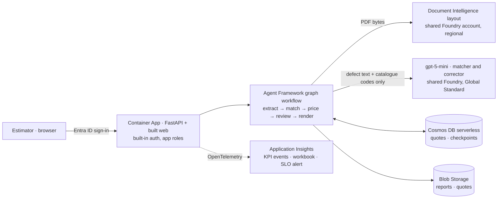
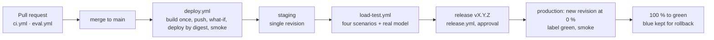

# Architecture

Elevant turns a lift inspection report into a priced, reviewed and traceable Word quote. This page shows what runs where, how a
request flows, and how a change reaches production. The product, its requirements and its SLOs are in [PRODUCT.md](PRODUCT.md);
the decisions are in [adr/](adr/).

## Components

| Component | What it does | Defined in |
|---|---|---|
| Container App `ca-elevant-<env>` | One container, 0.5 vCPU and 1 GiB: the FastAPI API and the built React web from the same origin; scales from 0 on HTTP concurrency | `infra/modules/app.bicep`, `Dockerfile` |
| Built-in auth | Signs users in with Entra ID (ID tokens, no client secret) and passes `X-MS-CLIENT-PRINCIPAL`; `/healthz` and `/api/version` stay open | `app.bicep` (`authConfigs`), ADR-010 |
| Workflow | `extract` (Document Intelligence), `match` (matcher agent), `price` (code), `review` (`request_info`), `render` (docxtpl) | `app/workflow.py`, ADR-002 |
| Cosmos DB for NoSQL, serverless | `quotes` (`/id`) and `checkpoints` (`/workflow_name`), TTL = retention, continuous 7-day backup, local auth off | `infra/modules/data.bicep`, ADR-004 |
| Blob Storage, hot LRS | `reports` and `quotes`, shared key off, soft delete 7 days, lifecycle deletion at retention | `data.bicep` |
| Key Vault | RBAC only, soft delete and purge protection; empty in v1 | `data.bicep`, ADR-010 |
| Log Analytics and Application Insights | 31 days, daily cap, Entra-authenticated ingestion; KPI events, workbook, SLO alert (production) | `infra/modules/monitoring.bicep`, `infra/workbook.json` |
| Budget | Monthly, actual 50/80/100 % and forecast 100 % | `infra/modules/budget.bicep` |
| Shared base | Registry `craiplatformshared`, Foundry account `fdry-aiplatform-shared-swc` (`gpt-5-mini` `2025-08-07`, Document Intelligence) | `rg-aiplatform-shared-swc`, ADR-005 |

## A quote, end to end

1. The estimator signs in; the platform sets the principal headers and the API checks the app role.
2. `POST /api/quotes` with the PDF: size and type are checked, Document Intelligence reads at most 11 pages, and the draft streams
   back as server-sent events: reading, matching, pricing, then the quote at the `request_info` pause (REQ-05's clock stops there).
3. Each review answer (`POST /api/quotes/{id}/review`) rebuilds the workflow from the quote's own checkpoint, applies the edit in code
   and returns the priced quote. Corrections in plain words are proposed by the corrector and applied only on confirmation.
4. Approval renders the `.docx` from the pinned template, stores it in Blob and emits `quote_approved`; the document is downloadable
   only from then on.

## Identities

| Identity | Created by | Roles |
|---|---|---|
| `id-elevant-<env>` (user-assigned) | `02-app-identity.sh` | `AcrPull` on the registry and `Foundry User` on the Foundry account (script); Cosmos DB Built-in Data Contributor, `Storage Blob Data Contributor`, `Monitoring Metrics Publisher` on its own environment (Bicep) |
| `gh-product-industrial-elevant-<env>` (CI) | `01-azure.sh` | `Contributor` and conditioned `Role Based Access Control Administrator` on its group; staging `AcrPush` and `Foundry User`, production `AcrPull` |
| `elevant-web-<env>` (sign-in) | `02-app-identity.sh` | App roles `Quote.Estimator` and `Quote.Manager`, assignment required; staging's `Quote.Estimator` is also held by the staging CI principal for the load test |
| The operator, staging only | Bicep, from `OPERATOR_PRINCIPAL_ID` | Data access to staging Cosmos DB and storage, to export recorded runs; production has no human data access |

## Environments and promotion

Staging (`rg-elevant-stg-swc`) and production (`rg-elevant-prod-swc`) are separate groups with separate everything that holds data
or bills while idle; only the registry and the Foundry account are shared. The tables of environments, costs and sizes are in
[PRODUCT.md](PRODUCT.md) and [cost.md](cost.md).

- **Build once.** `deploy.yml` builds the image on the runner, tags it `YYYYMMDD-main-<sha7>`, pushes it, and deploys it by digest.
- **Release gate.** `release.yml` refuses a tag whose commit has no successful merge deployment and no successful load test, and waits
  for the owner's approval in the `production` environment.
- **Blue/green.** The release's revision starts at 0 % behind the `green` label and takes the traffic only after `/healthz` and
  `/api/version` answer with the expected digest (ADR-009).
- **Rollback.** `--label-weight blue=100 green=0` in an emergency, or `release.yml` on the previous tag; staging rolls back with
  `deploy.yml` and the previous tag.
